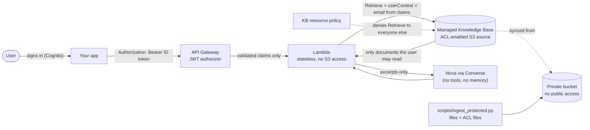

# Protected mode: document-level access control

Set `KB_ACCESS_MODE=protected` to answer only from documents the **signed-in end user** may
read. It uses [Amazon Bedrock Managed Knowledge Base ACL awareness][acl]: every document in an
ACL-enabled S3 data source carries an allow/deny list of user emails, and `Retrieve` returns only
documents the supplied `userContext.userId` may read. The model never decides who may see what.

This is the AWS counterpart of the Azure Purview and Google Agent Search modes, with **one
difference that matters**: AWS does not authenticate the user inside the retrieval call. AWS
documents this plainly ("ACL awareness is not authorization"): Bedrock trusts the `userId` it is
given and filters by it. Azure and GCP bind the user's own token to the search. Here the binding is
done by the deployment, in three layers:

1. **API Gateway JWT authorizer** validates the user's Cognito ID token (signature, issuer,
   audience, expiry) before the function runs.
2. **The function reads the email only from those validated claims** (and re-checks issuer, audience,
   `token_use=id` and `email_verified`). Headers and body fields are never identity; a body that
   carries `userContext`, `userId`, `email`, `sessionId`, `memoryId` and so on is rejected with 400.
3. **A resource policy on the knowledge base denies `bedrock:Retrieve` to every principal except
   the function's role**, so nobody can call Retrieve directly with an arbitrary `userContext`.

Anyone who can change that policy, assume the function role, or edit the function can impersonate any
user. Treat those IAM permissions as the security boundary.



## Identity prerequisites

* A **Cognito user pool** (created by Terraform) holds the users. Users are admin-created only, and the
  email attribute is immutable because ACLs match the **exact email**.
* Each user's **verified email must equal the `Name` in the document ACL**. A mismatch silently returns
  nothing. If an email is reassigned to another person, update the ACLs and re-sync.
* IAM Identity Center and an AWS Organization are **not** required. The AWS account only needs Bedrock
  Managed Knowledge Base in your region (see the [region list][regions]; us-east-1 is included).
* **Not used:** Amazon Q Business and Amazon Kendra (both closed to new customers in July 2026),
  Verified Permissions (decides but does not filter retrieval), S3 Access Grants/ABAC (control direct
  S3 reads, not knowledge base retrieval).

## What gets deployed

`KB_ACCESS_MODE=protected bash scripts/provision.sh` then `bash scripts/deploy.sh` (separate Terraform
root `terraform/protected` with its own state; the sample deployment is untouched):

| Resource | Protection |
|---|---|
| Private S3 bucket | All four public-access blocks, BucketOwnerEnforced (no ACLs), TLS-only, SSE, no website |
| Managed knowledge base + S3 data source | Created by `provision_protected.sh` (AWS CLI; the Terraform provider's support for this KB type was not verified). `aclEnabled=true`; no vector store to run |
| KB service role | Read-only on the private bucket |
| Cognito user pool + app client | Admin-created users, immutable email, no client secret |
| API Gateway HTTP API | One route, `POST /ask`, JWT authorizer, throttled. No `$default` route, no Lambda URL |
| Lambda role | `Retrieve` + metadata reads on **this** KB, `InvokeModel` on one model, logs. No S3 access |
| KB resource policy | `Deny` Retrieve/GetDocumentContent unless `aws:PrincipalArn` is the Lambda role (`deploy.sh`) |

No static access keys are created. `deploy.sh` fails if any route lacks the JWT authorizer or the function
has a URL. The sample corpus in `docs/` is never uploaded. The sample CI jobs skip themselves when the
repository variable `KB_ACCESS_MODE` is `protected`. Sample evals, telemetry, the Bedrock Agent, memory and
OpenSearch Serverless are not part of this mode.

```bash
export KB_ACCESS_MODE=protected ENV_NAME=<env> REGION=us-east-1
bash scripts/provision.sh   # bucket, roles, Cognito, managed KB + ACL-enabled data source
bash scripts/deploy.sh      # Lambda, API, KB lock; optional acceptance gate
bash scripts/teardown.sh    # deletes everything above and verifies nothing is left
```

Models: the answer model is `amazon.nova-lite-v1:0` (`BEDROCK_MODEL_ID` overrides). It was `ACTIVE` with no
end-of-life date in us-east-1 when checked; check the
[model lifecycle page][lifecycle] before pinning, and note that some newer models are only available through
inference profiles. The sample mode's reranker default was `amazon.rerank-v1:0`, which is **not supported in
us-east-1**; it now defaults to `cohere.rerank-v3-5:0`.

Cost (from the Bedrock pricing page, not measured): $5 per GB-month of raw data stored, $1 per 1,000 Retrieve
calls, managed parsing, embeddings and reranking $0; Nova tokens at on-demand rates; Cognito, API Gateway and
Lambda are cents at test volumes. There is no OpenSearch Serverless collection in this mode.

## Ingest a corpus

Keep the approved corpus in a directory **outside** this repository (the script refuses paths inside it)
with an `acl.json` manifest. Every file needs an explicit entry. S3 ACLs support **users only**, as email
addresses; there are no groups and no "everyone". A document with no ACL is counted as a **failed document** by
the sync (observed live), so an entry with no users is **not uploaded at all** and is never searchable.

```json
{"policy.pdf": {"users": ["alice@example.com", "bob@example.com"]},
 "draft.txt":  {"users": []}}
```

```bash
python3 scripts/ingest_protected.py --bucket <bucket> --knowledge-base-id <kb> \
  --data-source-id <ds> --directory /path/outside/repo --region us-east-1
```

It checks the destination (private bucket, active managed KB, ACL-enabled data source on that bucket),
uploads each document plus `<name>.metadata.json` with `accessControlList`, **deletes anything else under
`docs/`** (so the index follows the manifest), starts a sync, and succeeds only if the job completes with zero
failed documents and no failure reasons. Supported types: `.txt`, `.md`, `.html`, `.pdf`, `.docx`. Your
operator needs S3 write on the bucket and `bedrock:StartIngestionJob`/`Get*` on the knowledge base.

## Calling the API

Your app signs the user in with Cognito and sends the **ID token** (not the access token) to your API:

```
POST <api-url>/ask
Authorization: Bearer <Cognito ID token>
{"input": "<question>", "store": false, "background": false}
```

* Do not log or trace tokens. Send no conversation, session or memory fields; `store` must be `false`.
* Do not cache protected answers or replay them into later requests.
* The response is `{"status":"completed","text":…,"sources":[filenames]}`: source filenames only, no public
  URLs. A user with no readable matches gets a completed "could not find information" response.
* No CORS is configured: call this from your backend, or add CORS deliberately for your own origin.

## Access control is eventually consistent after a sync

AWS says ACL changes are "eventually consistent" and "typically take effect within a few minutes", and that S3
sources have no real-time verification, so a change applies only after the next sync. **In one small live run no
exposure was seen** (see Live validation), but GCP showed a non-reader sporadically retrieving the restricted document for
about ten minutes after a fresh import, so assume the same until the gate has run against your deployment:

* Treat a newly imported or changed corpus as exposed until verified; keep real traffic off it.
* Re-run the gate after every re-sync, including ACL changes and revocations.
* The gate (`scripts/test_protected_live.py`) does not trust one denied check. It requires `--clean-streak`
  (default 30) **consecutive** clean denied-user checks, resetting on any exposure, within `--settle-timeout`
  (default 1500 s), warns on every exposure seen while settling, and re-checks at the end.
* `--acl-change-test` swaps the restricted file's reader from A to B, re-syncs, and times when B is granted and
  A is revoked (stable for several consecutive checks). Use it to measure revocation latency, not guess it.

## Verify before accepting traffic

Create two synthetic fixtures in a dedicated directory outside the repo: a restricted file only user A may read
and a control with a different fact that only a third identity (`control-owner@<domain of user A>`, created by
nobody) may read, so it is indexed and ACL-filtered but neither test user may see it. Save this non-secret JSON outside the checkout:

```json
{
  "directory": "/absolute/path/to/synthetic-fixtures",
  "allowed_user": "usera@example.com",
  "denied_user": "userb@example.com",
  "approved_file": "approved.txt",
  "control_file": "control.txt",
  "question": "What is the restricted test access code?",
  "expected": "ORCHID-47",
  "control_question": "What is the unrestricted control code?",
  "control_expected": "MAPLE-82"
}
```

```bash
export PROTECTED_ACCEPTANCE_CONFIG=/absolute/path/to/protected-acceptance.json
PROTECTED_ACCEPTANCE_ARGS="--mint-users --acl-change-test" bash scripts/deploy.sh   # non-interactive
# or run scripts/test_protected_live.py directly (needs `pip install httpx boto3`)
```

* **Prompt mode** (default): paste user A's and B's Cognito ID tokens (and optionally an expired one) at hidden
  prompts. They are never echoed or saved.
* **`--mint-users`**: creates the two synthetic users in the deployment's pool, sets random passwords generated
  locally (never printed), mints a fresh ID token for every check, and **deletes both users at the end**. It
  refuses if either email already exists. The gate's operator needs the Cognito `Admin*` actions, S3 write,
  Bedrock sync permissions and `lambda:InvokeFunction`.

The gate fails the command unless user A gets the fact with a citation; user B gets a completed response with no
documents (after the settle streak); the control is never disclosed or cited; browser identity headers change
nothing; body-supplied `userContext`/`userId`/`email` and stateful requests (`store`, `sessionId`, `memoryId`,
`previous_response_id`, `conversation`) are rejected with 400; missing, invalid, swapped-claim and (if supplied)
expired tokens are rejected; a **direct `Retrieve` with the operator's own credentials and A's email is denied** by
the resource policy; a direct Lambda invoke without validated claims returns 401; and anonymous S3 reads and bucket
listing are denied.

## Live validation

One disposable run in us-east-1 (env `pm-test`, a temporary account, torn down and verified empty afterwards).
Provisioning worked first time (knowledge base ACTIVE and data source AVAILABLE in about two minutes). Four things
only showed up live and are fixed and covered by tests:

* `GetDataSource` returns `connectorParameters` as a **JSON string**, so the runtime check failed closed until it
  parsed it.
* A document **without an ACL counts as a failed document** in the sync (`failed=1`, "Some documents could not be
  crawled"), not a silent skip. So no-reader files are no longer uploaded, and the acceptance control now carries an
  ACL for a third identity instead.
* `Retrieve` returns the location as `https://<bucket>.s3.amazonaws.com/<key>`, not `s3://`; matching on `s3://`
  dropped every result.
* `terraform destroy` fails unless `terraform/protected/lambda_build` exists and is non-empty (teardown now creates a
  placeholder), and teardown must tolerate a knowledge base that is already gone.

| Check | Result |
|---|---|
| Sync of two ACL documents | Completed, 0 failed |
| User A (reader) | Completed answer with the restricted fact and the `approved.txt` citation, <1 s, 7 s cold |
| User B (not a reader) | Completed response with no documents: **30 consecutive clean checks, 0 exposures**, then 12 more clean at the end |
| Control (indexed, readable only by a third identity) | Not disclosed or cited when A asked |
| Forged identity headers; body `userContext`/`userId`/`email` | Ignored (result unchanged); 400 |
| Missing, invalid and swapped-email-claim token | 401 |
| `store=true`, `sessionId`, `memoryId`, `previous_response_id`, `conversation` | 400 |
| Direct Lambda invoke without validated claims | 401 |
| Anonymous S3 object read and bucket listing | 403 |
| **KB resource policy, ordinary IAM role** (separate probe, role had an explicit `Retrieve` allow) | `AccessDeniedException`: the lock works |
| **KB resource policy, account root user** | **Not blocked** (the gate fails unless run with `--allow-root-operator`, which prints that the lock was not verified) |
| ACL swap (A to B), then re-sync | Enforced as soon as the sync reported complete: B granted and A denied at the first check, stable for 65 s (one document; not a general bound) |
| Teardown | 20 Terraform resources plus the knowledge base removed; independent listing showed no KBs, buckets, user pools, Lambdas, APIs, roles, users or log groups left |

Not exercised: a genuinely **expired** token; the exposure window right after the very first import (the denied-user
streak ran after a re-sync, where no exposure was seen, and a first sync of an earlier run only checked user A);
larger corpora and groups of documents; the sample mode's rerank change; the application sign-in (SRP or hosted UI).
Keep the guidance above anyway: treat a newly imported corpus as exposed until the gate passes.

## What this does NOT prove

* **The account root user is not restricted by the knowledge base resource policy** (observed live: root retrieved
  with an arbitrary `userContext` despite the explicit Deny). Do not use root, and keep the KB policy and function
  role under tight IAM. An ordinary role was denied.
* **Not user authentication by AWS.** Bedrock filters by the email it is given; correctness rests on Cognito, the
  JWT authorizer, the function code and IAM. Anyone able to invoke the function directly, assume its role, or edit
  the resource policy or function can retrieve as any user.
* **Not file encryption.** It verifies retrieval filtering, not that objects are unreadable to people with bucket
  or KMS access. Bucket IAM stays your control. Objects use SSE-S3.
* **Propagation is "a few minutes" per AWS and unmeasured here.** ACLs change only by re-syncing; revocation is
  effective only after a sync completes and verification passes. For urgent removal, delete the object and sync,
  or take the API out of service.
* **Exact-email matching.** A reassigned or differently-cased email silently loses (or gains) access. S3 ACLs are
  users only; groups are not supported.
* **Not production app sign-in.** The gate mints tokens with admin auth. Your app must use Cognito (SRP or the
  hosted UI) and send the ID token. The app client allows admin password auth, which needs IAM credentials.
* Protected mode keeps no memory or stored conversations. Do not enable content logging for it or put restricted
  files in `docs/`.

After a test, run `bash scripts/teardown.sh` with the same variables. It deletes the knowledge base and
everything Terraform created, then checks that no bucket, KB, Lambda, role, user pool, API or log group is left.
Identities you created yourself are not touched.

[acl]: https://docs.aws.amazon.com/bedrock/latest/userguide/kb-managed-acl.html
[regions]: https://docs.aws.amazon.com/bedrock/latest/userguide/kb-managed-regions.html
[lifecycle]: https://docs.aws.amazon.com/bedrock/latest/userguide/model-lifecycle.html
